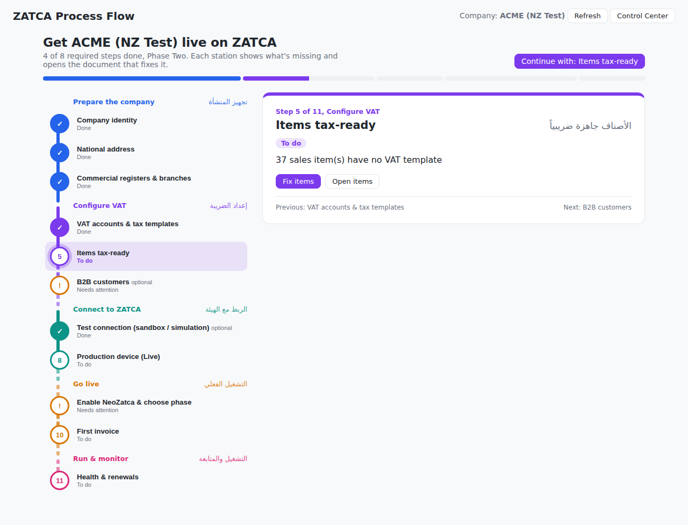

# NeoZatca — ZATCA E-Invoicing for ERPNext

NeoZatca brings Saudi ZATCA (Zakat, Tax and Customs Authority) e-invoicing compliance — Phase 1 and Phase 2 — to Frappe/ERPNext v15 and v16.

Publisher: **Neotec Integrated Solutions** · Support: **support@neotec.ai**

## 🗺️ Process Flow



**/app/zatca-process-flow** walks a company from an empty setup to live e-invoicing: each station
shows what's missing, straight from your data, and opens the document that fixes it.

## ⚡ One-click onboarding

Enter the company details once (VAT number, Arabic name, CR, national address), open
**Company → ZATCA → ZATCA Quick Setup**, paste the Fatoora **OTP** — and NeoZatca generates
everything else automatically:

| # | Artefact | # | Artefact |
|---|----------|---|----------|
| 1 | CSR config | 6 | Certificate (compliance, then production) |
| 2 | CSR | 7 | Basic auth from compliance CSID |
| 3 | PIH (initial previous-invoice hash) | 8 | Compliance request ID |
| 4 | Private key (secp256k1) | 9 | Final auth (production CSID) |
| 5 | Public key | | + compliance documents submitted for you |

Runs in the background with live progress, resumes from the failed step, and keeps keys and
secrets at System-Manager-only permission level.

## 🧭 Phases, environments and the Control Center

- **Phase One and Phase Two**, with a site default and a per-company override (groups in different waves).
- **Production (Live), Simulation and Sandbox** per device, with the right portal and OTP guidance for each.
- **ZATCA Control Center** (`/app/zatca-control-center`): phase, readiness, devices, certificate expiry and
  7-day submission health per company, with one-click links to the Fatoora and Developer portals.
- Invoice banners when a Phase Two company has no device or only a test device; daily certificate-expiry alerts.

---

## 🚀 Main Features
Fully compliant with Saudi Arabia's ZATCA E-Invoicing Phase 2 requirements. Includes XML generation, cryptographic stamping, and API integration with the Fatoora portal.

### **ZATCA Phase 1**
- Generate **Simplified Invoices** with embedded QR codes.
- ZATCA-compliant print formats for Phase 1.

### **ZATCA Phase 2**
- **Automatic CSR generation** and submission to ZATCA.
- Securely create and manage **compliance tokens**.
- Perform **system compliance tests** as per ZATCA UBL standards.
- Real-time **API compliance tests** to ensure readiness.
- Obtain **production tokens** for live ZATCA integration.
- Submit **Standard Invoices** for clearance and **Simplified Invoices** for reporting.
- Handle **credit and debit notes** for both clearance and reporting.
- Automatically attach QR codes to invoices.
- Maintain **success logs** for future reference.
- Access detailed **error logs** for troubleshooting.
- ZATCA dashboard with reports to compare statistics with the ZATCA portal.

### **Additional Features**
- Easy Self Installation.
- Support all Tax Category 
- Multi-device setup.
- Batch and live processing modes.
- Embedded XML and QR codes without impacting storage.
- Tax exemption reasons support.
- Compliance validation logs.
- Sandbox testing support.
- Simulation test support.
- Show the request-response XML
- User-friendly onboarding wizard.
- ZATCA print formats for both Phase 1 and Phase 2.
- Built-in troubleshooting and error detection.

---

## 💡 Why Choose NeoZatca?

NeoZatca is designed to be the **best-in-class ZATCA compliance app**. Here's why:
1. **Speed**: Optimized for fast processing with minimal delays.
2. **Ease of Use**: Simple workflows and an intuitive interface.
3. **Comprehensive Features**: Covers all ZATCA compliance scenarios and more.
4. **Scalability**: Ideal for multi-company and multi-device environments.
5. **Reliability**: Built using clean, modular code for high maintainability.

---

## 📦 Installation


### **Self Hosting**
Follow these steps to install NeoZatca on your ERPNext setup:

1. Get the app:
   ```bash
   bench get-app https://github.com/jamunachi08/neozatca.git
   ```
2. Setup requirements:
   ```bash
   bench setup requirements
   ```
3. Build the app:
   ```bash
   bench build --app neozatca
   ```
4. Restart the bench:
   ```bash
   bench restart
   ```
5. Install the app on your site:
   ```bash
   bench --site [your.site.name] install-app neozatca
   ```
6. Run migrations:
   ```bash
   bench --site [your.site.name] migrate
   ```

---

## ✅ Testing

Run Frappe-dependent tests through Bench so they execute inside a real site context. Replace `[your.site.name]` with your own local or CI site name:

```bash
bench --site [your.site.name] run-tests --app neozatca
```

Run a specific module:

```bash
bench --site [your.site.name] run-tests --app neozatca --module neozatca.zatca.tests.test_invoice
```

Generate coverage data with Bench. Keep `--app neozatca` in the command so coverage is collected for the app correctly:

```bash
bench --site [your.site.name] run-tests --app neozatca --module neozatca.zatca.tests.test_invoice --coverage
```

Bench stores coverage files under the `sites/` directory. Generate a terminal report or HTML report from there:

```bash
cd ../sites
python -m coverage report -m --include="*/apps/neozatca/*"
python -m coverage html
```

The HTML report will be written to:

```text
sites/htmlcov/index.html
```

---

## 🛠️ How to Use

NeoZatca is designed to be user-friendly and intuitive. 

### Documentation
Full documentation lives in **[`docs/`](docs/README.md)**, organized by domain:

- **New to ZATCA?** [Concepts & glossary](docs/concepts.md)
- **Implementers / accountants:** [Onboarding](docs/onboarding/user-guide.md) · [Submission](docs/submission/user-guide.md) · [Prepayment](docs/prepayment/user-guide.md) · [Configuration](docs/setup/configuration.md)
- **Developers:** [Architecture](docs/reference/architecture.md) · [DocTypes](docs/reference/doctypes.md) · [Submission pipeline](docs/submission/reference.md)

---

## Compatibility

| Frappe / ERPNext | Python | Node (Bench Group) | Status |
|------------------|--------|--------------------|--------|
| v15 | 3.10 – 3.14 | 18 or 20 | Supported |
| v16 | 3.14 | 24 | Supported |
| v17 (develop) | 3.14 | 24 | Checked against the development branch; full support confirmed on release |

The app itself needs no Node build (the onboarding wizard ships pre-built). Before allowing a new
major, run `python3 scripts/check_versions.py version-NN` and the CI matrix, then raise the bound
in `pyproject.toml`.

## Installation

```bash
bench get-app https://github.com/jamunachi08/neozatca.git
bench --site <your-site> install-app neozatca
bench --site <your-site> migrate
```

On Frappe Cloud, add the GitHub repository as a custom app to a v15 or v16 bench, then install it on the site.

## Developing the onboarding wizard

The wizard (`zatca-onboarding/`, React + Vite) ships pre-built in `neozatca/public/zatca-onboarding/`,
so Frappe Cloud never builds it. After editing it, run `yarn build:onboarding` from the app folder
inside a bench and commit the regenerated bundle.

## Support

support@neotec.ai

## License

MIT — see `LICENSE`.
